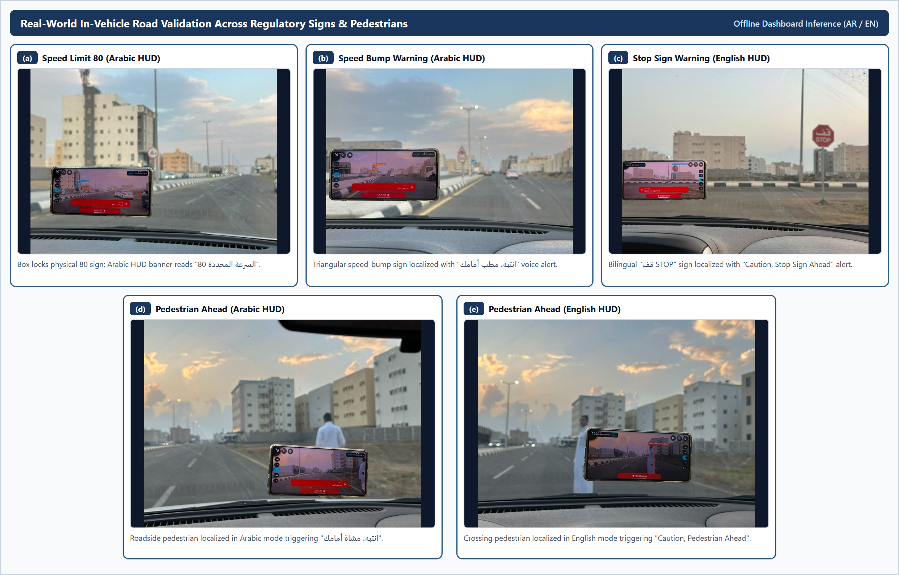
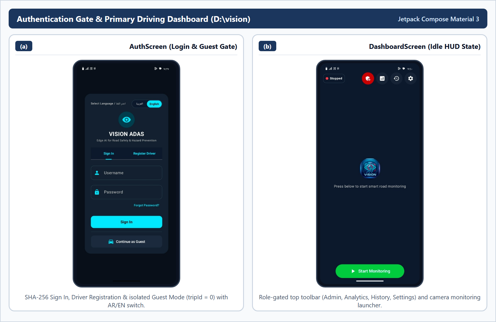
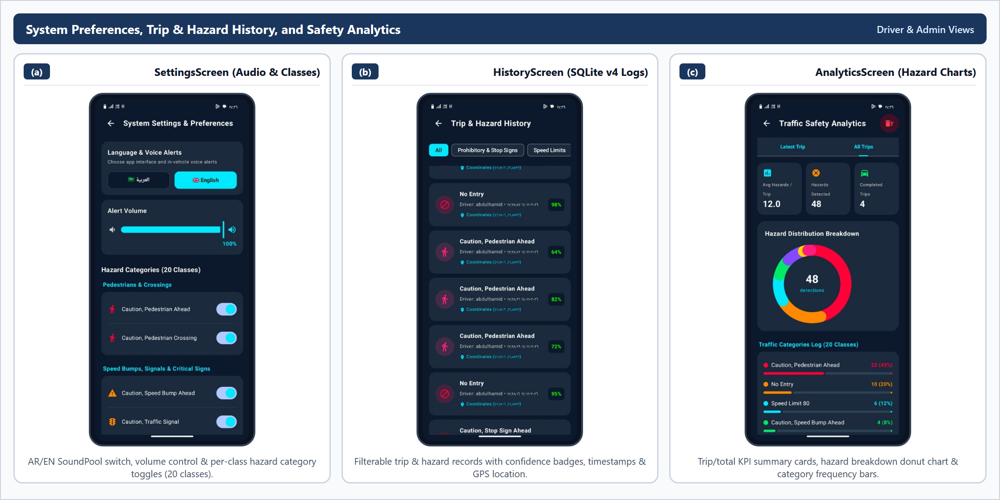
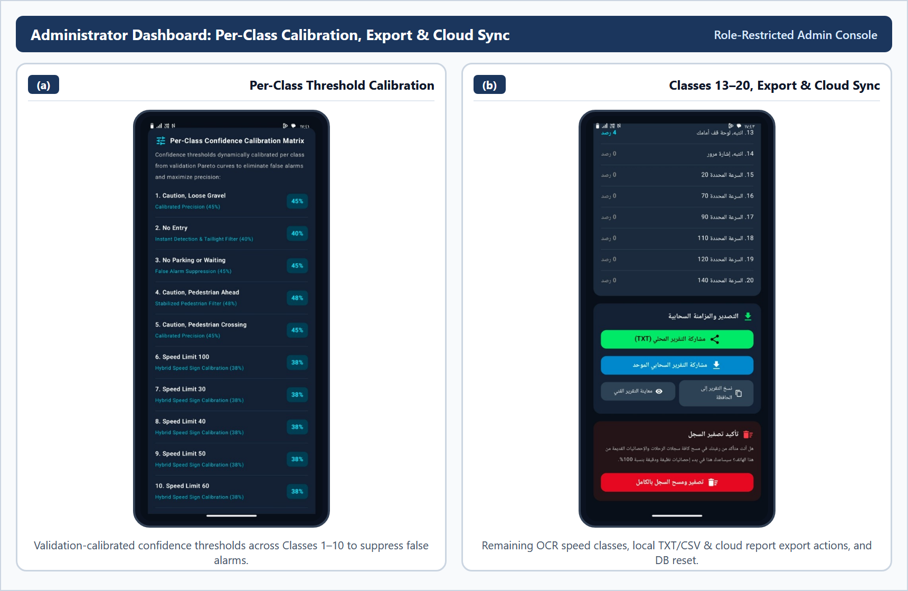
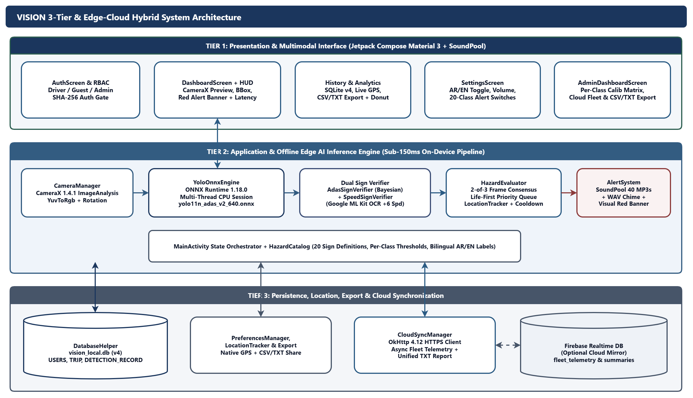
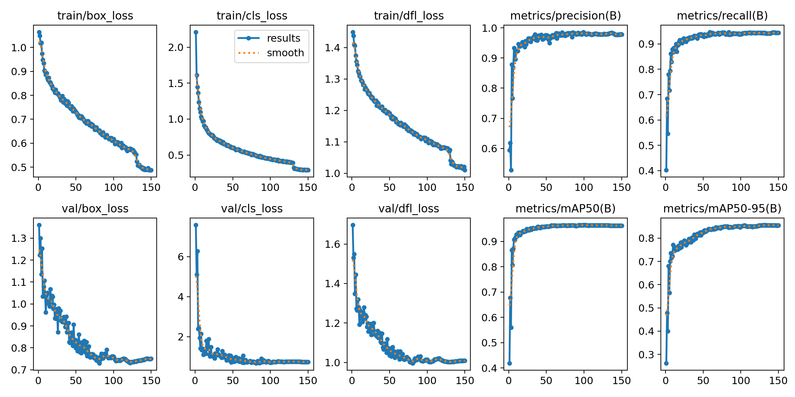
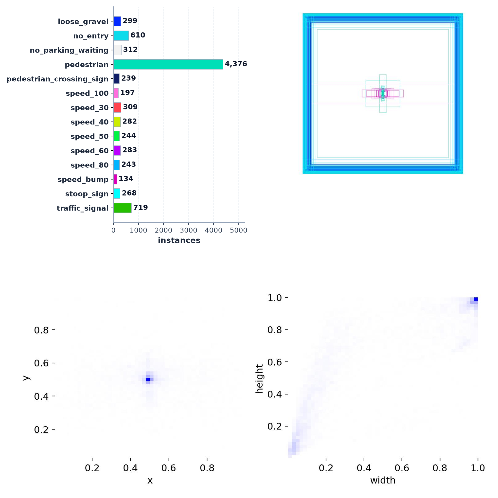

<div align="center">

# VISION: An Intelligent Driving Agent for Enhanced Road Safety

**Offline-First Edge AI Advanced Driver-Assistance System (ADAS) for Arabic & Regional Road Environments**

[-3DDC84?logo=android&logoColor=white)](#android-implementation)
[](#unified-multi-architecture-benchmark)
[](#dataset--leak-free-protocol)
[](../../releases/tag/v1.0.0)
[](LICENSE)

</div>

> **Safety Disclaimer:** VISION is an experimental research prototype developed for educational and benchmarking purposes. It is **not** a certified automotive safety system and must not be relied upon as a substitute for attentive human driving.

---

## 1. Project Overview

**VISION** is a real-time, privacy-preserving, **offline-first Edge AI driving agent** built for Android devices. Unlike cloud-dependent ADAS applications that suffer from cellular latency and dead zones, VISION runs its entire perception and warning stack inside local volatile device memory: **CameraX** capture, **YOLOv11n** inference via **ONNX Runtime**, **Bayesian HSV + edge verification**, **Google ML Kit** zero-shot OCR for speed-limit signs, **2-of-3 frame temporal consensus**, and preloaded bilingual **SoundPool** voice alerts.

On a strictly held-out, unaugmented test split of **884 Arabic road images (`1,278` instances)**, the deployed `YOLOv11n-ADAS-v2` (FP32 ONNX, `10.12 MiB`) achieves **95.82% mAP@50**, **97.17% Precision**, **93.05% Recall**, and **85.62% mAP@50-95** at **34.58 ms** mean CPU inference latency (~28.9 FPS)—**10.8× faster** than transformer-based `D-FINE-N`.

---

## 2. Live Road Validation & Application Screenshots

### Real-World In-Vehicle Road Trials (Arabic & English HUD)
<p align="center">
  
</p>

### Jetpack Compose Material 3 Interface Suite
<p align="center">
  
</p>

<details>
<summary><b>View Settings, Trip History, Safety Analytics & Admin Console Screenshots</b></summary>

<p align="center">
  
</p>
<p align="center">
  
</p>

</details>

> **Live Demo Video:** A 60–90 second unedited smartphone road-test recording demonstrating real-time offline detection and bilingual Arabic/English voice prompts will be linked here in an upcoming update.

---

## 3. Key Features

- **100% Offline Core Perception:** Zero cloud calls or network sockets required for detection, OCR, voice alerts, or local SQLite trip logging; raw camera frames live only in reusable volatile `FloatBuffer`s.
- **Hybrid 14 + 6 = 20-Class Detection:** Detects 14 trained visual classes directly via `YOLOv11n` and promotes 6 additional zero-shot speed-limit classes (`20, 70, 90, 110, 120, 140 km/h`) at runtime via `SpeedSignVerifier` (Google ML Kit OCR) without retraining.
- **False-Positive Suppression:** Combines `AdasSignVerifier` (Bayesian HSV & edge heuristics) with a `2-of-3` frame temporal consensus evaluator (`HazardEvaluator`).
- **Role-Based Access Control (RBAC):**
  - *Guest (`tripId = 0`):* Live alerts with zero database or cloud writes.
  - *Registered Driver:* SHA-256 local authentication, GPS-tagged SQLite v4 trip logs, History & Analytics.
  - *Administrator:* Per-class confidence threshold calibration across all 20 classes, CSV/TXT export, and strictly opt-in Firebase RTDB summary sync.
- **Bilingual Audio Feedback:** 40 preloaded Arabic & English MP3 voice prompts dispatched via `SoundPool`.

---

## 4. System Architecture

<p align="center">
  
</p>

<details>
<summary><b>Additional Pipeline & Security Diagrams</b></summary>

- **End-to-End ML Process Flow:** [`diagrams/ml_pipeline_process_flow.png`](diagrams/ml_pipeline_process_flow.png)
- **Bayesian & OCR Dual-Verification Pipeline:** [`diagrams/pipeline_bayesian.png`](diagrams/pipeline_bayesian.png)
- **Security & Volatile-RAM Privacy Architecture:** [`diagrams/security_architecture.png`](diagrams/security_architecture.png)

</details>

---

## 5. Unified Multi-Architecture Benchmark

All four candidate detectors were evaluated under identical Colab x86 CPU benchmarking conditions to verify compliance with the `< 150 ms` end-to-end real-time driving safety budget. **Validation metrics** and **Held-Out Unseen Test metrics** are reported separately to prevent evaluation ambiguity:

### A. Validation Split Benchmark (`n = 1,767` unaugmented images | Colab CPU Latency)

| Model | Params / GFLOPs | Export Format & Size | Val Precision | Val Recall | Val mAP@50 | Val mAP@50-95 | Mean CPU Latency | Verdict |
| :--- | :---: | :--- | :---: | :---: | :---: | :---: | :---: | :--- |
| **YOLOv11n-ADAS-v2** | **2.59M / 6.5G** | **FP32 ONNX (`10.12 MiB`)** | **98.11%** | **94.22%** | **96.33%** | **85.62%** | **34.58 ms (~28.9 FPS)** | **Selected (10.8× vs. D-FINE-N)** |
| YOLO26n | 2.51M / 5.9G | INT8 TFLite (`2.76 MiB`) | 98.0% | 94.7% | 96.8% | 82.5% | 118.6 ms (~8.4 FPS) | Superseded (lower mAP@50-95 & 3.4× slower) |
| D-FINE-N (DEIM) | 3.73M / 7.13G | FP32 ONNX (`14.54 MB`) | 89.6% | 87.6% | 97.0% | 86.4% | 373.82 ms (2.7 FPS) | Rejected (>150 ms budget; 6 GridSample ops) |
| RT-DETRv2-S | 20.1M | ONNX / Ckpt | 100.0% | 98.1% | 96.7% | 86.2% | 681.45 ms (~1.5 FPS)* | Rejected (1,735 ms on mobile CPU) |

*\*`RT-DETRv2-S` measured `681.45 ms` on Colab CPU and stalled at `1,735 ms` on mobile CPU.*

### B. Held-Out Unseen Test Evaluation (`YOLOv11n-ADAS-v2`, `n = 884` images, `1,278` instances)

| Metric | Unseen Test Score | Notes |
| :--- | :---: | :--- |
| **mAP@50** | **95.82%** | Strictly unaugmented, never seen during training or threshold tuning |
| **Precision** | **97.17%** | Only 5 inter-class confusions across all 1,278 ground-truth boxes |
| **Recall** | **93.05%** | Hardest classes: `speed_bump` (`76.34%`) and distant `pedestrian` (`83.64%`) |
| **mAP@50-95** | **85.62%** | — |

<p align="center">
  
</p>

---

## 6. Dataset & Leak-Free Protocol

- **Total Curated Dataset:** `8,842` Arabic & regional road images (`12,203` annotated bounding boxes across 14 trained visual classes).
- **Strict Leak-Free Split (applied prior to any augmentation):**
  - **Train:** `6,191` images (70%) — 3× low-gamma night `speed_bump` oversampling and retro-reflection applied *exclusively* here.
  - **Validation:** `1,767` images (20%) — 100% clean, unaugmented.
  - **Unseen Test:** `884` images (10%) — 100% clean, unaugmented.
- **Download:** The full dataset archive (`Offline.Arabic.ADAS.yolov11.zip`, 529 MB) is hosted in **[GitHub Releases v1.0.0](../../releases/tag/v1.0.0)**. See [`dataset/Dataset.txt`](dataset/Dataset.txt) for Roboflow export usage (supply your own `ROBOFLOW_API_KEY`).

<p align="center">
  
</p>

---

## 7. Android Implementation

- **Language & UI:** Kotlin, Jetpack Compose Material 3 (`minSdk = 26`, `arm64-v8a` / `armeabi-v7a`).
- **Camera & Inference:** CameraX `1.4.1` → `YoloOnnxEngine` (`com.microsoft.onnxruntime:onnxruntime-android:1.18.0`, bundled `yolo11n_adas_v2_640.onnx`).
- **Verification & Storage:** Google ML Kit On-Device Text Recognition `16.0.1`, Bayesian HSV verifier, SQLite v4 (`DatabaseHelper`), OkHttp `4.12.0` (opt-in telemetry only).
- **Automated Verification:** `12/12` passing Gradle JVM unit tests (`HazardCatalog`, `LocationTracker`, `Export`, `HazardEvaluator`).

```text
├── android-app/            # Kotlin + Jetpack Compose Android application & ONNX engine
├── training/               # Colab training & ONNX/TFLite export notebooks (YOLOv11, YOLO26, D-FINE, RT-DETRv2)
├── dataset/                # Roboflow download script (archive hosted in Releases v1.0.0)
├── diagrams/               # Architecture, ML lifecycle, Bayesian & security diagrams
├── screenshots/            # Real smartphone UI captures, road trials & training curves
├── CHANGELOG.md            # Release changelog
├── SHA256SUMS.txt          # Cryptographic checksums for v1.0.0 release assets
├── CITATION.cff            # Citation metadata
└── LICENSE                 # MIT License
```

---

## 8. Installation & Integrity Verification

### Option A: Install Pre-Built Public Demo APK
1. Download `app-debug.apk` from **[Releases v1.0.0](../../releases/tag/v1.0.0)**.
2. Verify file integrity against [`SHA256SUMS.txt`](SHA256SUMS.txt):
   ```bash
   sha256sum -c SHA256SUMS.txt
   ```
3. Enable *Install unknown apps* on an Android 8.0+ (`arm64-v8a` / `armeabi-v7a`) device and install.

### Option B: Build from Source
1. Open `android-app/` in **Android Studio**.
2. Create `android-app/local.properties` (excluded from Git):
   ```properties
   sdk.dir=YOUR_ANDROID_SDK_PATH
   # Optional: only required if enabling Admin Firebase RTDB sync
   CLOUD_BASE_URL=https://your-project-id-default-rtdb.firebaseio.com
   ```
3. Run unit tests and build:
   ```bash
   cd android-app
   ./gradlew testDebugUnitTest assembleDebug
   ```

---

## 9. Known Limitations

Transparent engineering documentation of current system boundaries:
- **Challenging Lighting & Weather:** Detection recall drops on low-contrast night `speed_bump` surfaces (`76.34%` mAP@50 on unseen test) and distant small `pedestrian` targets (`83.64%`), as well as under heavy dust, rain, or direct sun glare.
- **Occasional Sign Misclassification:** Visually similar circular regulatory signs or partially occluded digits can occasionally trigger OCR/classification drift despite Bayesian and `2-of-3` temporal filtering.
- **Hardware Variance:** CPU latency benchmarks (`34.58 ms` mean on Colab x86 CPU) vary across Android SoCs depending on thermal throttling and mobile ARM core configurations.
- **Non-Certified Prototype:** Not validated against ISO 26262 or automotive functional safety standards; intended strictly for research, demonstration, and edge-AI benchmarking.

---

## 10. Future Improvements

- **Lane Detection & Road Segmentation:** Integrate lightweight semantic lane segmentation alongside object detection.
- **Hardware NPU / NNAPI Acceleration:** Benchmark ONNX Runtime NNAPI / QNN execution providers on modern mobile NPUs.
- **Quantization-Aware Training (QAT):** Close the `mAP@50-95` gap seen in post-training INT8 quantization while further reducing mobile inference latency and thermal load.
- **Night & Adverse-Weather Expansion:** Expand night-time speed-bump and rain/dust subsets with real dashboard dashcam footage.

---

## 11. Authors & Citation

| Name | Role |
| :--- | :--- |
| **Abdulhamid Alaboud** | Project Manager, Lead Architect & AI/ML Engineer |
| **Ahmed Alaglan** | Database & Backend Engineer |
| **Edris Khawaji** | Security & Cloud Telemetry Analyst |
| **Faisal Ageeli** | QA & Verification Engineer |
| **Abdullah Arishi** | Systems Architect & Data Curator |
| **Hussain Abutaleb** | UI/UX & Audio Designer |

If you reference this codebase, benchmark, or dataset, please cite using [`CITATION.cff`](CITATION.cff). Licensed under the [MIT License](LICENSE).
